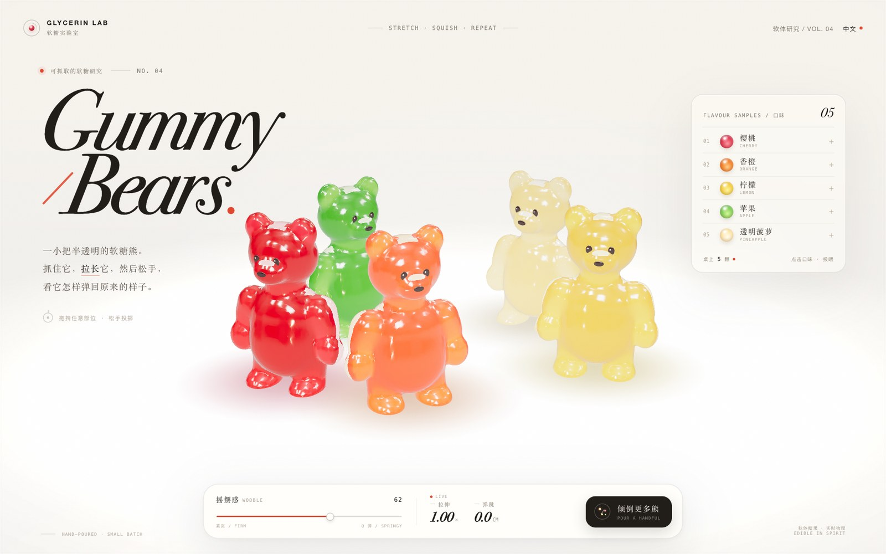

# ClycerinLib · 软糖小人实验室

> 一小把半透明的软糖熊，落在白色桌子上。抓住它，拉长它，松手看它弹回。

**在线演示 → [https://jdb156158.github.io/ClycerinLib/](https://jdb156158.github.io/ClycerinLib/)**

[](https://jdb156158.github.io/ClycerinLib/)

## 玩法

- **拿起并拉伸**：拖拽任意部位，软糖熊会像橡皮一样拉长，身体随之倾斜，松手带阻尼回弹。
- **压扁**：按住头部向下拖，熊会压成煎饼、向两侧鼓起，松手后弹回。
- **扔出去**：快速拖拽后松手，熊会飞出去、落地挤压、弹跳并撞开其他熊。
- **再倒一把**：点击“倾倒更多熊”，新的软糖熊会从上方落进摇晃的堆里。

## 页面

- 白色编辑风产品页，大号斜体衬线标题 **Gummy / Bears.**
- 右侧口味卡：樱桃红、香橙、柠檬黄、苹果绿、透明菠萝
- 摇摆滑块，以及实时的“拉伸”和“弹跳”读数
- 圆形光标在抓取时放大；桌面与手机均有适配
- ACES 色调映射、PMREM 环境反射、柔和主光与背光

## 技术

- `index.html` 为单一自包含文件，运行时仅依赖 CDN 上的 [three.js](https://threejs.org/)
- 平滑隐式表面 + Marching Cubes 构建连续软糖身体
- 软体粒子、形状匹配、拉伸细化、粒子碰撞与地面摩擦
- 程序化厚薄遮罩控制颜色吸收，半透明材质带有屏幕空间折射
- 按熊数量和实时帧率自适应渲染分辨率，保持 60fps 交互

## 文件

- [`index.html`](index.html) — 完整网页
- [`PROMPT.md`](PROMPT.md) — 本项目的原始提示词
- [`preview.jpg`](preview.jpg) — 页面预览图

## 本地运行

直接打开 `index.html` 即可（需要联网加载 three.js CDN）。也可以通过任意静态服务器预览：

```bash
python3 -m http.server 8000
# http://localhost:8000
```
